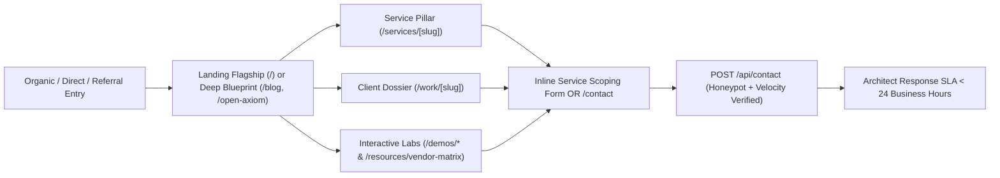

# Axiom Studio — Production Requirements Document (PRD)

- **Document ID**: `AXS-PRD-001`
- **Platform**: **Axiom Studio** (`https://axiomstudio.agency`)
- **Version**: `2.4.0`
- **Status**: Production-Ready Baseline + `antimatterai.agency` Motion Parity Upgrade
- **Source Codebase**: `https://github.com/qasim-987/Axioms-Labs.git` (Rebranded 100% to **Axiom Studio**)
- **Design & Motion Benchmark**: `https://antimatterai.agency` + `/Animations.md`

---

## 1. Executive Summary & Product Vision

**Axiom Studio** is an enterprise-grade digital flagship, autonomous AI systems showcase, and interactive technical studio platform built on **Next.js 14 (App Router)**, **React 18**, **TypeScript 5.6**, and **Tailwind CSS 3.4**.

Inspired by the dark-vault atmospheric craft and precision motion language of `antimatterai.agency`, **Axiom Studio** solves a critical market positioning challenge: traditional agency websites rely on static claims, whereas enterprise technical buyers evaluate partners by engineering velocity, architectural depth, deterministic evaluation rigor, and interface polish.

Axiom Studio bridges that gap by combining:
1. **Keynote-Grade Brand Storytelling**: Volumetric top-down light rays, split-character 3D kinetic typography, physical odometer counters, and tactile glassmorphic surfaces.
2. **Deep Architectural Proof**: 7 comprehensive enterprise client dossiers (`/work/[slug]`), 6 structured engineering service pillars (`/services/[slug]`), 4 technical blueprints (`/blog/[slug]`), and 9 open-source tools (`/open-axiom`).
3. **Hands-On Interactive Proof-of-Capability**: 6 live interactive AI & infrastructure labs (`/demos/*`) plus a sortable, filterable, CSV-exportable Enterprise AI Vendor Matrix (`/resources/vendor-matrix`).
4. **Hardened Lead Capture**: Anti-spam protected `POST /api/contact` backend pipeline with honeypot and submission-velocity bot rejection.

---

## 2. Target Personas & Ideal Customer Profiles (ICPs)

| Persona | Role & Organization | Core Pain Points | Primary Axiom Studio Touchpoints |
| :--- | :--- | :--- | :--- |
| **P1: The Enterprise CTO / VP of Engineering** | Technology executive at Series B–Fortune 500 enterprises scaling AI from pilot to production. | Stochastic LLM hallucinations, vendor lock-in, latency > 500ms, lack of deterministic evals. | `/`, `/services/ai-development`, `/services/ai-agents`, `/resources/vendor-matrix`, `/blog/*`, `/work/strata-systems` |
| **P2: The CISO / AI Security & Compliance Lead** | Security, Healthcare (HIPAA), or FinTech risk officer auditing sovereign AI deployments. | PHI/PII leakage, prompt injection, lack of VPC/on-prem isolation, compliance bottlenecks. | `/demos/threat-monitor`, `/services/healthcare-apps`, `/work/zenith-health`, `/work/helix-cyber`, `/resources/vendor-matrix` |
| **P3: The Chief Product Officer / Design VP** | Product leader commissioning a category-defining web flagship or high-cognition SaaS UI. | Slow legacy frontends (poor Core Web Vitals), generic SaaS templates, fragmented design-to-dev handoff. | `/services/ui-ux-design`, `/services/website-design`, `/services/website-development`, `/work/nova-commerce`, `Animations.md` craft |
| **P4: The Principal ML / Systems Engineer** | Technical evaluator performing due diligence before approving an external systems partner. | Marketing fluff without architectural substance or working interactive telemetry. | `/open-axiom`, `/demos/vector-search`, `/demos/infrastructure-atlas`, `/blog/building-ai-agents-that-survive-production` |

---

## 3. Business Objectives, Conversion Funnels & KPIs

### 3.1 Primary Conversion Funnels

### 3.2 Measurable Success Metrics (KPIs)

| Category | Metric | Target Threshold | Verification Method |
| :--- | :--- | :--- | :--- |
| **Performance** | Largest Contentful Paint (LCP) | `< 1.8s` (p75 Mobile & Desktop) | Lighthouse CI / Vercel Web Vitals |
| **Interactivity** | Interaction to Next Paint (INP) | `< 100ms` | Chrome UX / DevTools Performance |
| **Visual Stability** | Cumulative Layout Shift (CLS) | `< 0.02` | Lighthouse CI (strictly enforced during odometer & split-text reveals) |
| **Motion Fidelity** | Animation Frame Pacing | `60 FPS` sustained (`< 16.6ms` frame time) | Chrome Rendering FPS Meter + GPU Compositor Audit |
| **Bundle Efficiency** | Shared First-Load JS | `< 95 kB` gzipped (Baseline: `87.3 kB`) | `npm run build` Route Size Audit |
| **Accessibility** | WCAG 2.1 Level AA Compliance | `100 / 100` Lighthouse Accessibility Score | Axe-core + `@media (prefers-reduced-motion: reduce)` checks |
| **Bot Mitigation** | Automated Form Spam Rejection | `> 99%` automated scraper drop rate | `botField` honeypot + `< 1000ms` `formLoadedAt` velocity gate |

---

## 4. Complete Functional Requirements (All 42 Routes)

### 4.1 Global Shell (`Navbar.tsx` & `Footer.tsx`)
- **FR-NAV-01**: Fixed header transitioning at `window.scrollY > 20` from transparent (`py-5`) to obsidian glass (`bg-[#030303]/90 backdrop-blur-md border-b border-white/[0.08] py-3.5`).
- **FR-NAV-02**: Brand mark featuring `AX` monogram badge + `AXIOM STUDIO` wordmark + pulsing emerald operational status indicator + `AI & Systems Architecture` subtitle.
- **FR-NAV-03**: Desktop `Services` Mega-Menu exposing all 6 pillars with icons, badges, short descriptions, and a featured latest-work callout; `Resources` dropdown linking to `AI Vendor Matrix`, `Open Axiom`, `Engineering Blog`, and `Interactive Labs`.
- **FR-NAV-04**: Full keyboard Escape-key dismissal, outside-click dismissal, and accessible mobile navigation drawer (`< 768px`).
- **FR-FTR-01**: 5-column architectural footer (`Services`, `Case Studies`, `Resources`, `Demos & Labs`, `Company`) + live client-hydrated 1Hz `tabular-nums` local studio clock (`--:--:--` SSR placeholder to prevent hydration mismatch) + smooth scroll-to-top trigger + `© {year} Axiom Studio Inc.` legal bar.

### 4.2 Flagship Landing Page (`/`)
- **FR-HOME-01 (`Hero`)**: Top-down volumetric `LightRays` backdrop, `Axiom Studio` eyebrow pill, kinetic split-character `<h1>` headline (`Architecting Digital Systems That Think, Scale, and Matter.`), dual primary/secondary CTAs (`/contact` and `/work`), and 4 technical trust chips (`< 85ms Latency`, `SOC2 & HIPAA`, `MCP Native`, `99.99% SLA`).
- **FR-HOME-02 (`LogoStrip`)**: Seamless infinite horizontal partner marquee (`Strata Systems`, `Zenith Health AI`, `Vortex Capital`, `Helix Cybersecurity`, `Nova Commerce`, `Pulse Matrix`, `Synthetix Labs`, `Apex Protocol`) with dual edge alpha-fade masks and glowing horizon light curve (`Animations.md` §9).
- **FR-HOME-03 (`StatsSection`)**: Viewport-triggered physical vertical odometer counters (`74+` Production Deployments, `99.4%` Client Satisfaction, `94.8%` Agent Accuracy, and static `24/7` Telemetry & Uptime).
- **FR-HOME-04 (`ServicesGrid`)**: 6-pillar interactive grid displaying `01–06` indexed disciplines, expandable capability lists, benchmark metrics, cursor-tracked radial border spotlight, and deep links to `/services/[slug]`.
- **FR-HOME-05 (`Methodology`)**: 3-column deterministic engineering proof (`Autonomous Tool Protocol`, `Zero-Knowledge Isolation`, `Continuous Automated Evals`).
- **FR-HOME-06 (`CaseStudies`)**: Featured enterprise client showcase with verified ROI callouts (`84%`, `78%`, `<12ms`, `99.4%`), tech stack tags, and synchronized preview transitions (`Animations.md` §8).
- **FR-HOME-07 (`ContactSection`)**: Embedded validated scoping form wired directly to `POST /api/contact`.

### 4.3 Service Pillar Pages (`/services/[slug]` — 6 Dynamic/SSG Routes)
Routes: `/services/ui-ux-design`, `/services/website-design`, `/services/website-development`, `/services/ai-development`, `/services/ai-agents`, `/services/healthcare-apps`.
- **FR-SVC-01**: Discipline-specific hero with badge, headline, long architectural overview, benchmark metric pill, and tool stack badges (`service.tools`).
- **FR-SVC-02 (`What You Get`)**: 6 numbered deliverable cards per discipline (`title` + `description`).
- **FR-SVC-03 (`How We Work`)**: 4-phase structured delivery roadmap (`01` through `04`) with week durations, narrative descriptions, and tangible phase outputs.
- **FR-SVC-04**: Discipline-scoped inline consultation form + interactive keyboard-accessible FAQ accordion (`service.faqs`).

### 4.4 Portfolio Index (`/work`) & Case Study Dossiers (`/work/[slug]` — 7 SSG Routes)
Dossier slugs: `strata-systems`, `zenith-health`, `vortex-capital`, `helix-cyber`, `nova-commerce`, `pulse-matrix`, `synthetix-labs` (plus legacy `/case-study/[slug]` permanent redirects to `/work/[slug]`).
- **FR-WRK-01 (`/work`)**: Client-side instant category filter tabs (`All`, `AI Apps`, `Websites`, `Enterprise`) displaying all 7 dossiers with impact metric callouts and tech stack pills.
- **FR-WRK-02 (`/work/[slug]`)**: Executive summary, operational `challenge`, engineered Axiom Studio `solution`, 3 `architectureHighlights` cards, bulleted verified `results`, full `techStack`, and sequential Previous/Next dossier navigation.

### 4.5 Company Narrative (`/company`) & Contact Hub (`/contact`)
- **FR-CMP-01 (`/company`)**: Mission hero (*"Companies create products. Axiom Studio Creates Impact."*), origin narrative, interactive Showcase Reel player state toggle, 3 foundational pillars (`Design-First Innovation`, `Engineering Excellence`, `Real-World Impact`), 3 numbered Core Beliefs (`01–03`), and expandable company FAQ accordion.
- **FR-CNT-01 (`/contact`)**: Full scoping form (`firstName`, `lastName`, `email`, `service`, `budget`, `message`), global engineering hub cards (San Francisco & London), and engagement FAQ accordion.

### 4.6 Engineering Blog (`/blog` & `/blog/[slug]` — 4 SSG Routes), Open Axiom (`/open-axiom`), and AI Vendor Matrix (`/resources/vendor-matrix`)
- **FR-BLG-01**: Category filter (`All`, `Architecture`, `Strategy`, `Economics`, `Evaluation`) across 4 technical articles (`building-ai-agents-that-survive-production`, `fine-tuning-vs-rag-vs-prompting-decision-framework`, `what-ai-model-training-actually-costs`, `evaluating-ai-evals-metrics-and-trust-for-the-boardroom`) with author metadata, reading time, and structured `Key Takeaways` callout boxes.
- **FR-OPN-01 (`/open-axiom`)**: Filterable catalog (`All`, `Agent Skills`, `Templates`, `Apps`, `Tools`) of 9 permissive open-source packages with star/fork badges, license tags, GitHub links (`github.com/axiomstudio/*`), and 1-click clipboard copy for `npx` / `pip` install commands with visual checkmark confirmation.
- **FR-VND-01 (`/resources/vendor-matrix`)**: Interactive comparison matrix of 7 enterprise AI platforms (`OpenAI Enterprise`, `Anthropic Claude Enterprise`, `AWS Bedrock`, `Google Vertex AI`, `Azure OpenAI Service`, `Cohere Private Cloud`, `vLLM / Open Weights Sovereign`). Must support multi-chip boolean filtering (`Dedicated VPC`, `Self-Hosted / On-Prem`, `HIPAA Compliant`, `PQC Ready`), dynamic column sorting (`medianLatencyMs`, `toolCallingAccuracy`, `name`), and instant client-side Blob CSV export (`axiom_ai_vendor_matrix_YYYY-MM-DD.csv`).

### 4.7 Six Interactive Capability Labs (`/demos/*`) & Legacy Redirect Matrix
| Canonical Lab Route | Legacy Alias Redirect | Core Interactive Requirement |
| :--- | :--- | :--- |
| `/demos/threat-monitor` | `/demos/atom-red-team` | Live incrementing threat counters, interactive 16-cell MITRE ATLAS adversarial technique heatmap inspector, severity filter pills (`All`, `Critical`, `AI-Assisted`, `Agent-Level`), and auto-scrolling defense log stream. |
| `/demos/intent-iq` | `/atom-intentiq` | Real-time sensitivity threshold range slider (`50–100`) filtering enterprise prospect pipeline + 1-click personalized AI outreach draft synthesizer. |
| `/demos/infrastructure-atlas` | `/data-center-map` | Searchable global compute & subsea fiber PoP explorer (`Ashburn`, `Silicon Valley`, `Frankfurt`, `London`, `Tokyo`, `Singapore`) with live facility MW capacity, carrier tier, and simulated RTT ping telemetry. |
| `/demos/voice-sentiment` | `/lie-detector-demo` | Animated multi-bar acoustic spectrum analyzer, preset scenario switcher (`Executive Pitch`, `Incident Call`, `Forensic Witness`), micro-tremor Hz readout, and stress probability gauge. |
| `/demos/vector-search` | `/atom/search` | Instant as-you-type semantic vector retrieval across enterprise corpus categories with sub-50ms stopwatch readout and cosine similarity percentage badges. |
| `/demos/emotion-ai` | `/emotion-ai` | Live unstructured text input + preset switcher computing 4-axis emotional radar bars (`Positive`, `Urgency`, `Skepticism`, `Neutral`). |
| `/open-axiom` | `/open-antimatter` | Server-side `redirect("/open-axiom")` preserving zero dead bookmarks. |

### 4.8 Backend Contact API (`POST /api/contact`)
- **FR-API-01**: Accept JSON payload `{ firstName, lastName, email, service, budget, message, botField, formLoadedAt }`.
- **FR-API-02**: Silent `HTTP 200` honeypot drop if `botField` is non-empty (`[ANTI-SPAM] Honeypot triggered`).
- **FR-API-03**: Silent `HTTP 200` velocity drop if `Date.now() - Number(formLoadedAt) < 1000` (`[ANTI-SPAM] Rejected submission completed in < 1 second`).
- **FR-API-04**: Return `HTTP 400` with descriptive error message if `firstName`, `email`, or `message` is missing or if `email` fails RFC-compatible regex validation.
- **FR-API-05**: Log structured inquiry metadata (excluding raw PII message body from public stdout logs) and return `HTTP 200` confirmation with `receivedAt` ISO-8601 timestamp.

---

## 5. Non-Functional Requirements (NFRs)

1. **Brand Hygiene (`NFR-01`)**: Zero occurrences of `"Axiom Labs"`, `"Anti Quanta"`, or `"Antimatter"` in rendered UI, `<head>` metadata, OpenGraph tags, API JSON responses, or package manifests.
2. **Accessibility & Vestibular Safety (`NFR-02`)**:
   - Skip-to-content link (`<a href="#main-content">`) as the first focusable element in `RootLayout`.
   - Semantic landmarks (`<header>`, `<nav>`, `<main id="main-content">`, `<article>`, `<footer>`).
   - Full `@media (prefers-reduced-motion: reduce)` CSS and JS `useReducedMotion()` support disabling inertial scroll, canvas particle loops, marquee motion, and 3D text rotations while keeping 100% of text legible (`opacity: 1`, `transform: none`).
   - Split-character headings (`SplitTextReveal`) and vertical odometer strips (`RollingNumber`) must expose clean `aria-label` strings on parent nodes and `aria-hidden="true"` on internal animated spans so screen readers never read `"B u i l d i n g"` or `"0 1 2 3 4 5 6 7 8 9"`.
3. **Responsive Viewport Matrix (`NFR-03`)**: Zero horizontal overflow (`overflow-x-hidden`) and zero overlapping touch targets across `375px` (iPhone SE/Mini), `768px` (iPad Portrait), `1024px` (Laptop), and `1440px–2560px` (Studio Display).
4. **SEO & Social Graph (`NFR-04`)**: Dynamic per-route `<title>` and `<meta name="description">` via Next.js `Metadata` / `generateMetadata` across all static and `[slug]` pages, canonical OpenGraph tags (`siteName: "Axiom Studio"`, `url: "https://axiomstudio.agency"`), and `robots: { index: true, follow: true }`.

---

## 6. Out-of-Scope Boundaries & Release Sign-Off Criteria

### Out of Scope (Current Release)
- Multi-tenant user authentication / client portal login.
- Live Stripe checkout processing on `/open-axiom` (all Axiom Studio open-source items are free/permissive CLI installs).
- Live webcam/microphone hardware capture without explicit user opt-in (demos run deterministic in-browser simulations safe for corporate firewalls).

### Production Release Sign-Off Checklist
- [x] `npm run build` succeeds with `0` TypeScript or Next.js build errors across all `42` routes.
- [x] `grep -rn -i "axiom labs\|axiomlabs\|anti-quanta"` returns `0` matches across source files.
- [x] `POST /api/contact` passes valid payload (`200`), missing required fields (`400`), invalid email (`400`), honeypot trap (`200` silent drop), and `<1000ms` bot velocity trap (`200` silent drop).
- [x] All `antimatterai.agency` motion upgrades follow `/Animations.md` GPU compositor rules (`transform`/`opacity` only) and `prefers-reduced-motion` accessibility standards.

### Responsive motion implementation (2026-10-28)
See [responsive audit](responsive-audit.md) for changed files, actual constants, validation boundaries and outstanding device QA. Frontend-only changes; backend remains independently built/deployed.
