# Axiom Studio — Design Architecture

- **Document ID**: `AXS-DES-002`
- **Platform**: **Axiom Studio** (`https://axiomstudio.agency`)
- **Aesthetic Benchmark**: `https://antimatterai.agency` ("Obsidian Vault + Volumetric Indigo/Violet Light")
- **Motion Companion Spec**: `/Animations.md`

---

## 1. Design Philosophy & Aesthetic Direction

**Axiom Studio** synthesizes the theatrical, dark-room keynote atmosphere of `antimatterai.agency` with the information precision of mission-critical telemetry consoles. Every visual decision adheres to four foundational design axioms:

1. **Obsidian Vault Depth (`#030303`)**: Pure `#000000` flattens depth and causes OLED smearing; warm charcoal `#18181b` feels washed out. Axiom Studio anchors its canvas at `#030303` / `#020203`, layering translucent smoky glass (`rgba(14, 14, 18, 0.65)`) and hairline `1px` specular borders (`rgba(255, 255, 255, 0.08)`) so elevation is perceived through light refraction rather than heavy drop shadows.
2. **Directional Volumetric Light**: Light always originates from a deliberate physical source—either top-down volumetric god-rays (`LightRays`) illuminating the Hero stage, a sweeping planetary horizon rim-light (`clientsLightCurve` in `LogoStrip`), or a cursor-tracked `520px` radial spotlight gliding across interactive service cards.
3. **Editorial Display Meets Tabular Telemetry**: High-impact geometric sans-serif headlines (`tracking-tight`, `leading-[1.08]`, character-split 3D entrance) contrast sharply against crisp uppercase monospace metadata (`font-mono`, `tracking-widest`, `tabular-nums`) for indices (`01`–`06`), live clocks, latency readouts, and ROI metrics.
4. **Choreographed Physicality**: Nothing teleports. Scroll wheel input carries subtle velvet inertia (`Lenis lerp: 0.06`), numbers roll on physical `0–9` vertical strips, mega-menus settle on damped springs, and every motion curve shares the signature deceleration `cubic-bezier(0.16, 1, 0.3, 1)`.

---

## 2. Design Token System

### 2.1 Color Architecture (`tailwind.config.ts` & `src/app/globals.css`)

| Token Name | CSS / Tailwind Token | Hex / RGBA Value | Architectural Usage |
| :--- | :--- | :--- | :--- |
| **Canvas Primary** | `bg-background` / `--background` | `#030303` | Global `<body>` background and primary page canvas |
| **Canvas Deep** | `bg-[#020203]` | `#020203` | Alternating section wells (`Methodology`, `CaseStudies`, `Footer`) |
| **Surface 400** | `bg-surface-400` | `#050506` | Scrollbar track, recessed terminal wells |
| **Surface 300** | `bg-surface-300` | `#08080a` | Logo monogram inner plate, code blocks |
| **Surface 200** | `bg-surface-200` | `#0d0d0f` | Active hovered card base |
| **Surface 100** | `bg-surface-100` | `#121215` | Elevated modal / dropdown panels |
| **Surface 50** | `bg-surface-50` | `#18181b` | Secondary interactive pills and subtle badges |
| **Glass Surface** | `.glass-panel` | `rgba(14, 14, 18, 0.65)` | Primary card fill paired with `backdrop-filter: blur(16px)` |
| **Brand Light** | `text-brand-light` | `#c3c4f7` | High-luminance violet-white highlights, ray striations, active titles |
| **Brand Primary** | `bg-brand-primary` / `--accent-purple` | `#8587e3` | Primary CTAs, active indicators, icons, light-ray midtones |
| **Brand Hover** | `hover:bg-brand-hover` | `#9b9de9` | Primary button hover illumination |
| **Brand Muted** | `text-brand-muted` / `--accent-violet` | `#696aac` | Deep atmospheric gradients, secondary conic ray stops |
| **Brand Dark** | `bg-brand-dark` | `#3d3e75` | Deep badge borders and recessed accent fills |
| **Brand Glow** | `brand.glow` | `rgba(133, 135, 227, 0.25)` | CTA shadows (`shadow-brand-primary/25`) and card hover halos |
| **Ink Primary** | `text-white` / `--foreground` | `#ffffff` / `#f4f4f5` | Display headlines, stat counters, primary labels (`> 18:1` contrast) |
| **Ink Secondary** | `text-zinc-300` / `text-zinc-400` | `#d4d4d8` / `#a1a1aa` | Body copy, descriptions, navigation links (`> 7.5:1` WCAG AA contrast) |
| **Ink Muted** | `text-zinc-500` | `#71717a` | Decorative dividers, secondary captions, inactive indices |
| **Hairline Border** | `border-white/[0.08]` | `rgba(255, 255, 255, 0.08)` | Default structural section dividers and `.glass-panel` borders |
| **Status Operational** | `bg-emerald-500` / `text-emerald-400` | `#10b981` / `#34d399` | Live studio pulse LED, verified compliance checks |
| **Status Warning** | `text-amber-400` | `#fbbf24` | High-priority telemetry vectors, uptime/latency highlights |
| **Status Critical** | `text-rose-400` / `bg-rose-500/15` | `#fb7185` | Critical adversarial threat cells in `/demos/threat-monitor` |

### 2.2 Surface, Glassmorphism & Volumetric Shader Recipes

```css
/* 1. Core Smoked Glass Card */
.glass-panel {
  background: rgba(14, 14, 18, 0.65);
  backdrop-filter: blur(16px);
  -webkit-backdrop-filter: blur(16px);
  border: 1px solid rgba(255, 255, 255, 0.08);
}

/* 2. Interactive Elevation + Specular Rim Transition */
.glass-panel-hover {
  transition: all 0.3s cubic-bezier(0.16, 1, 0.3, 1);
}
.glass-panel-hover:hover {
  background: rgba(20, 20, 26, 0.85);
  border-color: rgba(133, 135, 227, 0.35);
  box-shadow: 0 12px 36px -10px rgba(133, 135, 227, 0.15);
  transform: translateY(-2px);
}

/* 3. Top-Down Volumetric God-Ray Cone */
.ray-conic {
  background: conic-gradient(
    from 180deg at 50% 0%,
    transparent 40deg,
    rgba(133, 135, 227, 0.18) 60deg,
    rgba(105, 106, 172, 0.28) 85deg,
    rgba(255, 255, 255, 0.35) 90deg,
    rgba(105, 106, 172, 0.28) 95deg,
    rgba(133, 135, 227, 0.18) 120deg,
    transparent 140deg
  );
  filter: blur(55px);
}
```

---

## 3. Typography & Editorial Hierarchy

Axiom Studio uses a dual-axis typographic system with OpenType stylistic sets enabled (`font-feature-settings: "cv02", "cv03", "cv04", "cv11"`):

| Role | Font Stack | Size Scale (Mobile → Desktop) | Weight & Tracking | Motion / Numeric Treatment |
| :--- | :--- | :--- | :--- | :--- |
| **Display Hero (`H1`)** | `font-sans` (`Inter` / Geist / SF Pro) | `text-4xl` (`2.25rem`) → `sm:text-6xl` (`3.75rem`) → `md:text-7xl` (`4.5rem`) | `font-extrabold` (`800`), `tracking-tight` (`-0.025em`), `leading-[1.08]` | `SplitTextReveal` (`22ms` char stagger) + gradient accent span (`from-white via-zinc-200 to-brand-primary`) |
| **Section Headline (`H2`)** | `font-sans` | `text-3xl` (`1.875rem`) → `sm:text-5xl` (`3rem`) | `font-extrabold` (`800`), `tracking-tight`, `leading-tight` | Viewport-triggered `SplitTextReveal` (`amount: 0.35`) |
| **Card / Pillar Title (`H3`)** | `font-sans` | `text-xl` (`1.25rem`) → `sm:text-2xl` (`1.5rem`) | `font-bold` (`700`), `tracking-tight` | Color shift `text-white` → `text-brand-primary` on group hover |
| **Lead / Subtitle Copy** | `font-sans` | `text-base` (`1rem`) → `md:text-xl` (`1.25rem`) | `font-normal` (`400`), `leading-relaxed` (`1.625`) | `text-zinc-400`, constrained to `max-w-2xl` (`65ch`) for optimal reading rhythm |
| **Eyebrow / Section Pill** | `font-mono` | `text-xs` (`0.75rem`, `12px`) | `font-medium`, `uppercase`, `tracking-wider` (`0.05em`) | Framed inside rounded pill `px-3 py-1 rounded-full bg-white/[0.05] border border-white/10` |
| **Odometer / KPI Metric** | `font-mono` | `text-4xl` (`2.25rem`) → `md:text-6xl` (`3.75rem`) | `font-bold` (`700`), `tracking-tight`, `tabular-nums` | Physical `0–9` vertical ribbon strip (`RollingNumber`) |
| **Telemetry / Micro-Meta** | `font-mono` | `text-[10px]`–`text-[11px]` | `font-semibold`, `uppercase`, `tracking-widest` (`0.1em`), `tabular-nums` | Used for `01–06` pillar indices, live clock, tech tags, and latency badges |

---

## 4. Layout Grid, Spatial Rhythm & Responsive Breakpoints

```mermaid
flowchart TB
    subgraph Viewport["Viewport Container (overflow-x: hidden, bg: #030303)"]
        Nav["Fixed Header Shell (z-50, max-w-7xl, px-4 sm:px-6 lg:px-8)"]
        HeroStage["Hero Stage (pt-36 md:pt-48, pb-20 md:pb-32, centered max-w-4xl + 950px LightRays)"]
        Ribbon["Partner Marquee + Horizon Light Curve (py-12, full-bleed track + 15% edge alpha masks)"]
        Stats["4-Column Odometer Bar (py-16, grid-cols-2 lg:grid-cols-4, border-y white/8)"]
        Services["6-Pillar Bento / Expandable Grid (py-24 sm:py-32, grid-cols-1 md:grid-cols-2 lg:grid-cols-3)"]
        Method["3-Pillar Deterministic Methodology (py-24, grid-cols-1 md:grid-cols-3)"]
        Cases["Split-Stage / 2-Col Case Studies (py-24 sm:py-32, 5/7 asymmetric lg:grid-cols-12)"]
        Contact["5/7 Split Contact Architecture (py-24, Info Rail + Validated Glass Form)"]
        Footer["5-Column Studio Footer + 1Hz Live Clock (pt-16 pb-12)"]
    end
    Nav --> HeroStage --> Ribbon --> Stats --> Services --> Method --> Cases --> Contact --> Footer
```



### Breakpoint System
- **Mobile (`375px – 639px`)**: Single-column card stacks (`grid-cols-1`), 2-column compact stats/trust chips (`grid-cols-2`), collapsible hamburger drawer, full-width pill CTAs (`w-full`), `px-4` (`16px`) horizontal gutters.
- **Tablet (`640px – 1023px`, `sm:` / `md:`)**: 2-column service & dossier grids (`md:grid-cols-2`), inline CTA buttons (`sm:w-auto`), `px-6` (`24px`) gutters.
- **Desktop (`1024px – 1279px`, `lg:`)**: Full desktop mega-menu bar, 3-column service matrix (`lg:grid-cols-3`), `5/7` split-stage Case Studies & Contact layouts (`lg:grid-cols-12`), sticky preview stages (`lg:sticky lg:top-28`), `px-8` (`32px`) gutters.
- **Studio Wide (`1280px – 1440px+`, `xl:`)**: Content locked cleanly to `max-w-7xl` (`1280px`) while atmospheric `LightRays` (`1400px`), `.horizon-light-curve` (`150%` width), and marquee ribbons bleed edge-to-edge.

---

## 5. Component Design Specifications & Interactive States

### 5.1 Navigation Header & Mega-Menu (`src/components/Navbar.tsx`)
- **Brand Lockup**: `32x32px` rounded-lg gradient border (`from-brand-muted via-brand-primary to-white p-[1px]`) framing `#08080a` inner square with `AX` bold monospace mark + `AXIOM STUDIO` + `6px` emerald pulsing dot.
- **Mega-Menu Panel**: `max-w-5xl` glassmorphic dropdown (`bg-[#09090d]/95 backdrop-blur-2xl border border-white/10 rounded-2xl shadow-2xl`) containing a 2-column grid of the 6 service pillars + bottom bar CTA to `/work` / featured case study preview.
- **Interactive States**:
  - `Default`: `text-zinc-300 bg-transparent`
  - `Hover`: `text-white bg-white/[0.04]`
  - `Open / Active`: `text-white bg-white/[0.08]`, chevron rotated `180deg` in `text-brand-primary`
  - `Focus-Visible`: `ring-2 ring-brand-primary/50 outline-none`

### 5.2 Service Pillar Cards (`src/components/ServicesGrid.tsx`)
- **Anatomy**: Monospace index (`01`–`06`) + Discipline badge + Icon container (`p-3 rounded-xl bg-white/[0.05]`) + Title + Summary + Expandable Deliverables list (`Check` icon in `text-brand-primary`) + Bottom benchmark metric footer + `ArrowUpRight` trigger.
- **Interactive States**:
  - `Hover / Active`: Cursor-tracked `520px` radial violet spotlight (`rgba(133,135,227,0.14)`), border brightens to `border-brand-primary/50`, corner arrow translates `(+2px, -2px)`.

### 5.3 Case Study Dossier Cards & Split-Stage (`src/components/CaseStudies.tsx` & `/work`)
- **Anatomy**: Client badge + Year + Category pill (`AI Apps` / `Websites` / `Enterprise`) + Highlighted Impact Metric Banner (`bg-gradient-to-r from-brand-primary/15 via-white/[0.02] to-transparent border border-brand-primary/20`) + Title + Summary + Monospace tech stack chips + `Read Case Study` link.
- **Split-Stage Upgrade (`Animations.md` §8)**: Left `01–06` selector rail with sliding `2px` `layoutId` active indicator bar paired with right sticky preview card cross-fading with subtle `scale(1.04 -> 1.0)` and `blur(8px -> 0px)`.

### 5.4 Interactive Capability Lab Consoles (`/demos/*` & `/resources/vendor-matrix`)
- **Console Aesthetic**: Framed as live enterprise operations HUDs using high-density dark cards (`bg-[#07070a]`), uppercase monospace telemetry headers (`INFERENCE LATENCY: 18MS`, `MODEL: AXIOM SENTIMENT-V4`), interactive range sliders (`accent-brand-primary`), filter pill toggles, and color-coded status badges.

### 5.5 Validated Scoping Form (`src/components/ContactSection.tsx`)
- **Input Anatomy**: `bg-white/[0.03] border border-white/10 rounded-xl px-4 py-3 text-sm text-white placeholder:text-zinc-600`.
- **States**:
  - `Focus`: `border-brand-primary ring-1 ring-brand-primary/50 bg-white/[0.05]`
  - `Submitting`: Disabled button with spinning loader indicator (`Submitting Parameters...`)
  - `Validation Error`: Rose alert banner (`bg-rose-500/10 border-rose-500/30 text-rose-300`)
  - `Success`: Full confirmation card state with check badge, architect 24h SLA message, and `Submit Another Inquiry` reset trigger.

---

## 6. Motion & Accessibility Integration Architecture

All visual components adhere strictly to `/Animations.md`:

| Interaction Class | Curve / Physics | Duration | Reduced-Motion Fallback (`prefers-reduced-motion: reduce`) |
| :--- | :--- | :--- | :--- |
| **Inertial Viewport Scroll** | `Lenis` (`lerp: 0.06`) | Continuous RAF | Disabled; reverts to native instant browser scroll |
| **Split-Character Headlines** | `cubic-bezier(0.16, 1, 0.3, 1)` | `720ms` + `22ms`/char | Renders plain unsplit `<Tag>{text}</Tag>` immediately at `opacity: 1` |
| **Odometer Digit Strips** | `cubic-bezier(0.16, 1, 0.3, 1)` | `1800ms` + `120ms`/col | Snaps directly to final target digit without vertical roll |
| **Mega-Menu / Stage Swap** | `cubic-bezier(0.16, 1, 0.3, 1)` / Spring (`380/32`) | `220ms – 500ms` | Instant state swap (`duration: 0.01ms`) |
| **LightRays & Marquee Loops** | `ease-in-out` / `linear infinite` | `6s – 28s` | Static ambient glow & static centered partner row |
