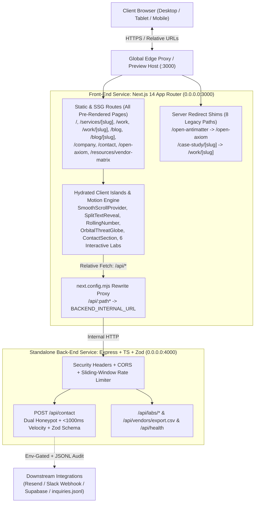
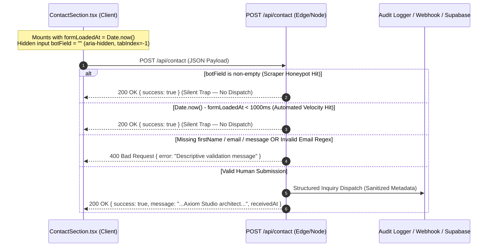

# Axiom Studio — Technical Architecture

- **Document ID**: `AXS-TECH-003`
- **Platform**: **Axiom Studio** (`axiom-studio@1.0.0`)
- **Framework**: Next.js `14.2.x` (App Router), React `18.3.1`, TypeScript `5.6.3`, Tailwind CSS `3.4.14`
- **Motion Companion Spec**: `/Animations.md`

---

## 1. High-Level System Architecture (Decoupled Front-End & Back-End Services)

Axiom Studio enforces a **strictly separated Front-End and Back-End Dual-Service Architecture**:
1. **Front-End Web Service (`src/`, Next.js 14 App Router on `0.0.0.0:3000`)**: Compiles all marketing flagships, service pages (`/services/[slug]`), engineering blueprints, client dossiers, and legacy shims ahead-of-time into static HTML + RSC payloads (`SSG`), while hydrating interactive capability islands (`"use client"`) and `antimatterai.agency` motion primitives (`Lenis`, `Framer Motion`, `GSAP`, `<canvas>` shaders). Zero API route handlers live inside `src/app/api`.
2. **Standalone Back-End API Service (`backend/`, Express + TypeScript + Zod on `0.0.0.0:4000`)**: Independently packaged REST service handling `/api/health`, `/api/contact` (dual honeypot + `<1000ms` velocity gate + IP sliding-window rate limiter + Zod validation + webhook/CRM/JSONL persistence), `/api/vendors/export.csv`, and live `/api/labs/*` telemetry & inference endpoints. Next.js `rewrites()` proxy `/api/:path*` cleanly to `BACKEND_INTERNAL_URL` so browser code uses strictly relative URLs.



---

## 2. Next.js 14 App Router & Rendering Strategy

### 2.1 Server Components (RSC) vs. Client Hydration Boundaries

To keep the shared First-Load JS bundle lightweight (`87.3 kB` baseline), Axiom Studio enforces strict **RSC-by-default** discipline:

| Component / Route | Boundary | Justification for Boundary Choice |
| :--- | :--- | :--- |
| `src/app/layout.tsx` | **Server (RSC)** | Emits global `Metadata`, `Viewport`, skip-link, and static HTML shell with zero client JS overhead. |
| `src/app/page.tsx` | **Server (RSC)** | Composes `Hero`, `LogoStrip`, `ServicesGrid`, `Methodology`, and `CaseStudies` on the server. |
| `src/app/work/[slug]/page.tsx` | **Server (SSG)** | Uses `generateStaticParams()` + `generateMetadata()` to pre-build all 7 client dossiers at build time. |
| `src/app/blog/[slug]/page.tsx` | **Server (SSG)** | Uses `generateStaticParams()` + `generateMetadata()` to pre-build all 4 technical blueprints at build time. |
| `src/app/case-study/[slug]/page.tsx` & 7 Legacy Shims | **Server Redirect** | Calls `redirect()` from `next/navigation` on the server with `160 B` route footprint. |
| `src/components/Navbar.tsx` | **Client (`"use client"`)** | Requires `window.scrollY` listener, Escape keydown listener, outside-click ref detection, and mega-menu state. |
| `src/components/RollingNumber.tsx` | **Client (`"use client"`)** | Requires `IntersectionObserver` to trigger odometer scroll animation when entering viewport. |
| `src/components/ContactSection.tsx` | **Client (`"use client"`)** | Manages controlled form inputs, `formLoadedAt` mount timestamp, `fetch("/api/contact")`, and submission UI states. |
| `src/components/Footer.tsx` | **Client (`"use client"`)** | Runs 1Hz `setInterval` live local clock and `window.scrollTo` smooth top button. |
| `src/app/demos/*/page.tsx` & `/resources/vendor-matrix` | **Client (`"use client"`)** | High-frequency interactive telemetry filters, sliders, live search timers, and Blob CSV generation. |

---

## 3. Complete Codebase Module & Directory Topology

```text
Axioms-Labs/                              # Repository Root (Brand: Axiom Studio)
├── AGENTS.md                             # Auto-discovered AI Coding Agent Instructions
├── Animations.md                         # Exact antimatterai.agency Motion & Shader Blueprint
├── MASTER_PROMPT.md                      # Master Architecture Generation Prompt
├── PROGRESS.md                           # Phase-by-phase build & verification log
├── README.md                             # Quickstart & platform overview
├── docs/                                 # Complete Production Architecture Suite
│   ├── 01-PRODUCTION-REQUIREMENTS-DOCUMENT.md
│   ├── 02-DESIGN-ARCHITECTURE.md
│   ├── 03-TECHNICAL-ARCHITECTURE.md
│   ├── 04-AGENT-INSTRUCTIONS.md
│   └── 05-TECHNICAL-WORKFLOW.md
├── next.config.mjs                       # Next.js configuration (reactStrictMode: true)
├── package.json                          # Manifest (name: "axiom-studio")
├── postcss.config.mjs                    # Tailwind + Autoprefixer pipeline
├── tailwind.config.ts                    # Custom surface/brand tokens & CSS keyframes
├── tsconfig.json                         # Strict TypeScript configuration (@/* -> ./src/*)
└── src/
    ├── app/
    │   ├── api/contact/route.ts          # POST /api/contact anti-spam endpoint
    │   ├── blog/                         # Engineering blog index + [slug] SSG reader
    │   ├── case-study/[slug]/page.tsx    # Legacy redirect -> /work/[slug]
    │   ├── company/page.tsx              # Studio narrative, showcase reel & core beliefs
    │   ├── contact/page.tsx              # Global hubs + scoping form + engagement FAQs
    │   ├── demos/                        # 6 Interactive Capability Labs
    │   │   ├── emotion-ai/page.tsx
    │   │   ├── infrastructure-atlas/page.tsx
    │   │   ├── intent-iq/page.tsx
    │   │   ├── threat-monitor/page.tsx
    │   │   ├── vector-search/page.tsx
    │   │   └── voice-sentiment/page.tsx
    │   ├── open-axiom/page.tsx           # Open-source catalog with 1-click CLI copy
    │   ├── resources/vendor-matrix/      # Enterprise AI comparison engine + CSV export
    │   ├── services/[slug]/page.tsx      # 6 Service pillar pages (deliverables, phases, FAQs)
    │   ├── work/                         # Portfolio filter gallery + [slug] SSG dossiers
    │   ├── globals.css                   # CSS variables, .glass-panel, .ray-conic, reduced-motion
    │   ├── layout.tsx                    # Root HTML shell, SEO Metadata, Viewport
    │   └── page.tsx                      # Flagship home composition
    ├── components/
    │   ├── CaseStudies.tsx               # Featured client dossiers / split-stage showcase
    │   ├── ContactSection.tsx            # Reusable validated scoping form
    │   ├── Footer.tsx                    # 5-col studio footer + live 1Hz tabular clock
    │   ├── Hero.tsx                      # Volumetric hero stage + trust chips
    │   ├── LightRays.tsx                 # Conic light-ray backdrop + parallax/dust shader
    │   ├── LogoStrip.tsx                 # Seamless infinite marquee + horizon light curve
    │   ├── Navbar.tsx                    # Sticky glass header + mega-menu + mobile drawer
    │   ├── RollingNumber.tsx             # Viewport-triggered odometer counter
    │   ├── ServicesGrid.tsx              # 6-pillar spotlight & expandable service cards
    │   └── StatsSection.tsx              # 4-metric KPI strip
    ├── data/
    │   ├── blog.ts                       # BlogPost[] + blogCategories
    │   ├── caseStudies.ts                # Re-export alias mapping clientsData -> caseStudiesData
    │   ├── clients.ts                    # ClientCaseStudy[] (7 enterprise dossiers)
    │   ├── navigation.ts                 # headerNavLinks, clientLogos, footerLinks
    │   ├── openSource.ts                 # OpenSourceItem[] (9 open-source tools/templates)
    │   ├── services.ts                   # ServiceItem[] (6 pillars, phases, FAQs, tools)
    │   └── vendorMatrix.ts               # VendorPlatform[] (7 enterprise AI providers)
    └── lib/                              # (Motion upgrade target per Animations.md)
        └── motionTokens.ts               # Shared cubic-bezier curves, springs & staggers
```

---

## 4. Data Layer & TypeScript Domain Contracts

All structured content currently lives in strongly typed, zero-latency TypeScript modules under `src/data/` so static pages compile with zero external database round-trips:

```ts
// 1. Service Pillar Contract (src/data/services.ts)
export interface ServiceItem {
  id: string;
  slug: string; // URL key for /services/[slug]
  title: string;
  badge: string;
  heroHeadline: string;
  shortDesc: string;
  longDesc: string;
  iconName: "Layout" | "Globe" | "Cpu" | "Bot" | "Shield" | "Cloud" | string;
  metrics: string;
  deliverables: { title: string; description: string }[]; // 6 items per service
  processPhases: {
    number: string; // "01".."04"
    title: string;
    duration: string;
    description: string;
    deliverables: string[];
  }[];
  faqs: { question: string; answer: string }[];
  tools: string[];
}

// 2. Enterprise Client Dossier Contract (src/data/clients.ts)
export interface ClientCaseStudy {
  id: string;
  slug: string; // URL key for /work/[slug]
  title: string;
  client: string;
  tagline: string;
  category: "AI Apps" | "Websites" | "Enterprise";
  impactMetric: string; // e.g., "84%", "<12ms", "99.4%"
  impactLabel: string;
  year: string;
  duration: string;
  summary: string;
  challenge: string;
  solution: string;
  architectureHighlights: { title: string; description: string }[];
  results: string[];
  techStack: string[];
  liveUrl?: string;
}

// 3. Enterprise AI Vendor Platform Contract (src/data/vendorMatrix.ts)
export interface VendorPlatform {
  name: string;
  provider: string;
  flagshipModel: string;
  deploymentModels: ("SaaS" | "Dedicated VPC" | "On-Prem / Self-Hosted")[];
  contextWindow: string;
  medianLatencyMs: number;
  dataPrivacyPolicy: "Zero Data Retention" | "Configurable Opt-Out" | "Enterprise BAA Only";
  hipaaCompliant: boolean;
  soc2Type2: boolean;
  pqcReady: boolean;
  toolCallingAccuracy: string;
  bestFitFor: string;
}
```

### Future Persistence & CMS Extension Path
When scaling to multi-editor workflows or persistent lead storage:
- **Lead Storage**: Connect `POST /api/contact` to a **Supabase** `contact_inquiries` PostgreSQL table with Row-Level Security (RLS) enabled (insert-only via server `SUPABASE_SERVICE_ROLE_KEY`).
- **Transactional Alerts**: Dispatch verified leads via `RESEND_API_KEY` (`Resend` HTTP API) or `CONTACT_WEBHOOK_URL` (Slack / Linear / HubSpot webhook).

---

## 5. API, Security & Anti-Abuse Architecture (`POST /api/contact`)

### 5.1 Multi-Layer Bot & Abuse Defense Sequence



### 5.2 Recommended Production Security Headers (`next.config.mjs`)

For hardened production deployments on Vercel or custom reverse proxies, configure HTTP response headers in `next.config.mjs`:
- `X-Content-Type-Options: nosniff`
- `X-Frame-Options: SAMEORIGIN` (Note: omit `DENY` in preview environments that render inside embedded IDE/platform preview iframes)
- `Referrer-Policy: strict-origin-when-cross-origin`
- `Permissions-Policy: camera=(), microphone=(), geolocation=()`
- **Rate Limiting**: Add sliding-window IP throttling (`5 requests / 10 minutes / IP`) via Upstash Redis or Vercel WAF on `/api/contact`.

---

## 6. Infrastructure, Deployment & Environment Contract

### 6.1 Environment Variables Contract (`.env.example`)

```bash
# Public Canonical Site URL
NEXT_PUBLIC_SITE_URL="https://axiomstudio.agency"

# Optional Downstream Contact Delivery (Server-Only — NEVER prefix with NEXT_PUBLIC_)
RESEND_API_KEY=""
CONTACT_NOTIFICATION_EMAIL="contact@axiomstudio.agency"
CONTACT_WEBHOOK_URL=""

# Optional Supabase Persistence (Server-Only Service Key for /api/contact)
SUPABASE_URL=""
SUPABASE_SERVICE_ROLE_KEY=""
```

### 6.2 Build & Runtime Characteristics
- **Static Route Count**: `42` compiled routes (`next build`).
- **Node.js Compatibility**: Node `18.17+`, `20 LTS`, `22 LTS`, and `24+`.
- **Zero External Image Host Dependency**: Renders instant vector icons (`lucide-react`), CSS shaders, and inline SVG/Canvas primitives—eliminating external CDN image 404s, CORS failures, and LCP layout shifts.


### Responsive motion implementation (2026-10-28)
See [responsive audit](responsive-audit.md) for changed files, actual constants, validation boundaries and outstanding device QA. Frontend-only changes; backend remains independently built/deployed.
