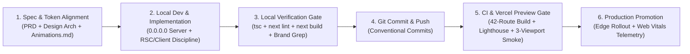
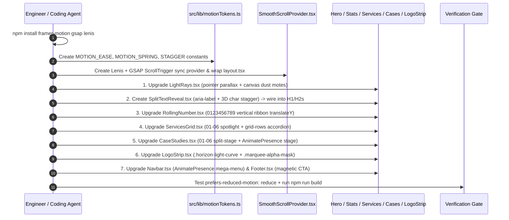

# Axiom Studio — Technical Workflow & Engineering Playbooks

- **Document ID**: `AXS-WFL-005`
- **Platform**: **Axiom Studio** (`axiom-studio@1.0.0`)
- **Companion Docs**: `/Animations.md`, `/AGENTS.md`, `docs/01`–`04`

---

## 1. End-to-End Engineering Lifecycle



---

## 2. Local Development & Environment Bootstrap

### 2.1 Initial Setup
```bash
# 1. Verify Node.js (>= 18.17.0) and npm
node -v && npm -v

# 2. Install exact locked dependencies
npm ci

# 3. Start local development server (bound to 0.0.0.0 for cloud/preview sandboxes)
npx next dev -H 0.0.0.0 -p 3000
```

### 2.2 Local Quality & Build Verification Commands
Run all four checks sequentially before opening or updating any pull request:

```bash
# 1. Strict TypeScript type-check (zero emit)
npx tsc --noEmit

# 2. Next.js ESLint check
npm run lint

# 3. Brand hygiene audit (must return 0 matches; exit code 1 is expected when clean)
! grep -rn -i "axiom labs\|axiomlabs\|anti-quanta" src/ README.md PROGRESS.md package.json

# 4. Full 42-route production build test
npm run build
```

---

## 3. Git Branching, Commit Conventions & PR Governance

### 3.1 Conventional Commit Prefixes
- `feat(motion): implement vertical 0-9 odometer strip in RollingNumber`
- `feat(demos): add orbital canvas arc visualization to threat-monitor`
- `fix(api): tighten email validation and rate-limit headers in /api/contact`
- `content(work): add new sovereign fintech case study dossier`
- `docs(arch): update technical architecture and animations spec`
- `refactor(ui): extract shared SpotlightCard primitive`

### 3.2 Pull Request Review Checklist
Every PR must confirm:
- [ ] **Brand Invariant**: Strictly uses **Axiom Studio** (`AXIOM STUDIO`, `axiomstudio.agency`).
- [ ] **Build Health**: `npm run build` compiles all static & dynamic routes with `0` errors.
- [ ] **Bundle Discipline**: Shared First-Load JS remains `< 95 kB` unless justified by approved motion libraries (`framer-motion`, `gsap`, `lenis`).
- [ ] **Accessibility & Motion**: `@media (prefers-reduced-motion: reduce)` and `useReducedMotion()` tested; no orphaned `setInterval` or `requestAnimationFrame` loops on component unmount.
- [ ] **Responsive Check**: Inspected at `375px` (Mobile), `768px` (Tablet), and `1440px` (Desktop) with zero horizontal scrollbars.

---

## 4. Standard Operating Playbooks (Step-by-Step SOPs)

### Playbook A — Implementing `antimatterai.agency` Animations from `Animations.md`

Follow this exact dependency order so foundational scroll and token layers exist before component upgrades:



**Critical Guardrails During Playbook A**:
1. Never split text without setting `aria-label={text}` on the heading tag and `aria-hidden="true"` on the animated span tree.
2. Never animate `height` directly on service accordions when CSS `grid-template-rows: 0fr -> 1fr` or Framer Motion `layout` can achieve 60fps without layout thrashing.
3. Always guard `window`, `document`, `IntersectionObserver`, and `requestAnimationFrame` inside `useEffect` to preserve clean SSR pre-rendering.

---

### Playbook B — Adding a New Client Case Study, Service Pillar, or Blog Blueprint

1. **New Case Study Dossier (`/work/[slug]`)**:
   - Append a typed `ClientCaseStudy` entry in `src/data/clients.ts` (`category` must be `"AI Apps"`, `"Websites"`, or `"Enterprise"`).
   - Optionally add a quick-link in `footerLinks.work` inside `src/data/navigation.ts`.
   - Run `npm run build` — `generateStaticParams()` in `src/app/work/[slug]/page.tsx` and `src/app/case-study/[slug]/page.tsx` will automatically generate both the dossier page and its legacy redirect!
2. **New Service Pillar (`/services/[slug]`)**:
   - Append a typed `ServiceItem` entry in `src/data/services.ts` with 6 `deliverables`, 4 `processPhases` (`01`–`04`), `faqs`, and `tools`.
   - Verify `iconName` maps cleanly in `ServicesGrid.tsx`, `Navbar.tsx`, and `src/app/services/[slug]/page.tsx`.
   - Add footer entry in `src/data/navigation.ts`.
3. **New Engineering Blog Article (`/blog/[slug]`)**:
   - Append a typed `BlogPost` object in `src/data/blog.ts` (`author.role` referencing `Axiom Studio`).
   - Run `npm run build` to verify static generation under `/blog/[slug]`.

---

### Playbook C — Creating a New Interactive Capability Lab (`/demos/[lab-slug]`)

1. Create `src/app/demos/<lab-slug>/page.tsx` marked `"use client"`.
2. Wrap page layout with `<Navbar />`, `<main id="main-content" className="min-h-screen pt-28 pb-24 bg-[#030303]">`, `<LightRays />`, and `<Footer />`.
3. Ensure all simulated timers (`setInterval`, `setTimeout`, `requestAnimationFrame`) return deterministic cleanup functions inside `useEffect`.
4. Register the lab in `src/data/navigation.ts` (`footerLinks.demos`) and `src/components/Navbar.tsx` (`Resources` dropdown / mobile menu).
5. End the lab page with a contextual conversion CTA linking to `/contact`.

---

### Playbook D — Wiring `POST /api/contact` to Production Resend / Webhook / Supabase

1. Add `RESEND_API_KEY` and/or `CONTACT_WEBHOOK_URL` in Vercel Project Settings (Environment Variables).
2. In `src/app/api/contact/route.ts`, after passing the `botField` honeypot, `<1000ms` `formLoadedAt` velocity gate, and email validation:
   - Dispatch an async `fetch("https://api.resend.com/emails", ...)` or `fetch(process.env.CONTACT_WEBHOOK_URL, ...)` with a `5000ms` `AbortController` timeout.
   - Return `HTTP 200` on confirmed delivery or `HTTP 502` if the downstream provider fails so the user is never silently misled.
3. Test all 5 API cases via `curl`:
   ```bash
   # 1. Valid human submission (>1000ms elapsed) -> Expect 200
   curl -s -X POST http://localhost:3000/api/contact \
     -H "Content-Type: application/json" \
     -d '{"firstName":"Qasim","lastName":"Architect","email":"qasim@enterprise.io","service":"AI Agents","budget":"$50k - $150k","message":"Need MCP multi-agent architecture review.","botField":"","formLoadedAt":1700000000000}'

   # 2. Missing required fields -> Expect 400
   curl -s -X POST http://localhost:3000/api/contact \
     -H "Content-Type: application/json" \
     -d '{"firstName":"","email":"","message":""}'

   # 3. Honeypot triggered -> Expect 200 silent trap
   curl -s -X POST http://localhost:3000/api/contact \
     -H "Content-Type: application/json" \
     -d '{"firstName":"Bot","email":"bot@spam.io","message":"spam","botField":"http://spam.io"}'
   ```

---

## 5. CI/CD Pipeline Blueprint (GitHub Actions + Vercel)

Create `.github/workflows/ci.yml` when enabling automated GitHub pull-request gates:

```yaml
name: Axiom Studio CI

on:
  push:
    branches: [main]
  pull_request:
    branches: [main]

jobs:
  verify-and-build:
    runs-on: ubuntu-latest
    steps:
      - name: Checkout Repository
        uses: actions/checkout@v4

      - name: Setup Node.js 20 LTS
        uses: actions/setup-node@v4
        with:
          node-version: 20
          cache: npm

      - name: Install Dependencies
        run: npm ci

      - name: Brand Hygiene Gate (Enforce Axiom Studio)
        run: |
          if grep -rn -i "axiom labs\|axiomlabs\|anti-quanta" src/ README.md PROGRESS.md package.json; then
            echo "❌ Legacy branding detected! Use 'Axiom Studio' exclusively."
            exit 1
          fi

      - name: TypeScript Strict Check
        run: npx tsc --noEmit

      - name: Next.js ESLint
        run: npm run lint

      - name: Production Build (All 42+ Routes)
        run: npm run build
```

---

## 6. Deployment Promotion & Instant Rollback Protocol

1. **Preview Deployment**: Pushing any branch automatically triggers a Vercel Preview URL (`https://<branch>-axiom-studio.vercel.app`). Verify Hero `LightRays`, odometer counters, mega-menu transitions, and `/api/contact` on mobile and desktop before merging.
2. **Production Promotion**: Merging to `main` promotes atomically to Vercel's global Edge CDN with zero downtime.
3. **Instant Rollback**: If post-deploy Real User Monitoring shows `CLS > 0.05`, `5xx` errors on `/api/contact`, or broken client hydration, execute an immediate atomic rollback in Vercel (`Deployments -> Previous Healthy Production Build -> Instant Rollback`) in `< 10 seconds`, then reproduce locally via `npm run build && npm run start`.
