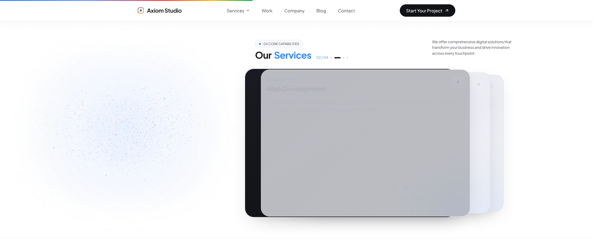
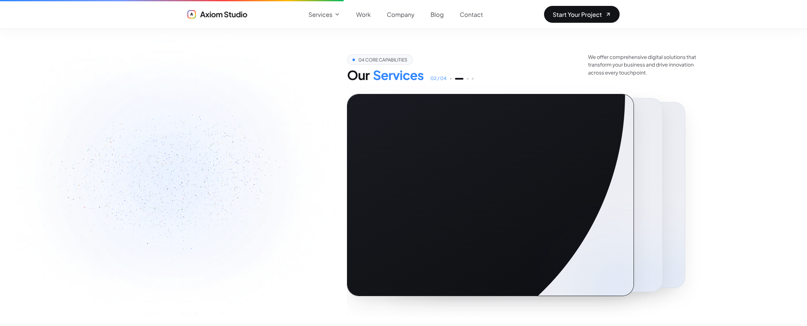
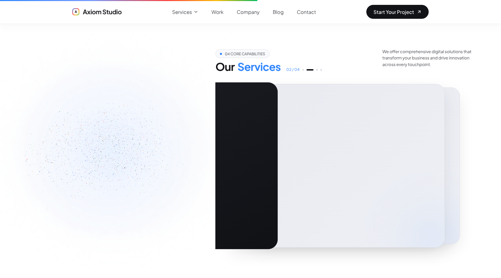

# Our Services — card-only animation correction

## Scope

Local implementation on `arena/eed48171-axioms-labs`; not committed, pushed, merged or deployed. Only runtime file changed: `src/components/ServicesGrid.tsx`. No changes to particle files, shape data, shaders, shared engine, particle progress assignment/smoothing, pin length, hold/transition windows, layout metrics, typography/copy, pricing, mobile carousel or reduced-motion fallback branches. `Animations.md` is the repository's motion reference (there is no singular `animation.md`).

## Root causes reproduced

- **A — gray/low contrast:** The original dark overlay interpolated `opacity` from 0 to 1 over the pale base while incoming content began revealing at transition t=.45. Opaque shells alone did not prevent that gray blend inside the incoming card.
- **B — exposed outgoing strip:** The old exit was a fixed -40px translation with visible overflow. The old dark shell remained behind the shifted incoming shell, including left of the column's rest edge.
- **C — counter/title mismatch:** The existing master counter already switched at t=.5, not at transition start. However, incoming content began at .45 and faded independently while the fill was still pale/gray. This made the number, readable title and dark activation appear disconnected.

## Implementation

- Separate opaque shell, explicit pale base, opaque dark ink, content and existing hover-effect layers. Ink uses `circle(0% at 0% 0%)` → `circle(150% at 0% 0%)`, never opacity interpolation.
- Outgoing content fades/rises before the exit; outgoing shell translates left by 35% of its measured width. The column clips with `inset(-48px -48px -48px 0)`. A complementary outgoing-shell inset prevents its remaining right portion lingering underneath the incoming card.
- Incoming shell advances from its existing responsive deck slot, still pale, then receives the cubic ease-in/out circular ink wipe. Text stays hidden until full ink coverage. Label/title/arrow/description/footer reveal in normalized stagger groups.
- Explicit front/incoming/deck z-order and isolation. Hover glow remains above the ink; hover handlers, lift, arrow and icon hover transforms are retained. Inline will-change hints on animated shell/ink/content nodes are released at rest.
- Counter and active title identity use the same explicit .5 midpoint. Dots animate width over250ms. Existing particle sampler and `.12` per-frame card progress smoothing remain unchanged.

## Constants

| Setting | Value |
|---|---|
| Outgoing content phase | t=0–.25, translateY 0→-8px |
| Movement phase | t=.15–.60, easeInOutCubic |
| Exit distance | -.35 × measured card width |
| Incoming movement | existing responsive first slot→0; scale .96→1 |
| Ink phase | t=.45–.80, easeInOutCubic |
| Ink geometry | circle radius0→150%, origin top-left |
| Incoming content phase | t=.80–1, translateY +8px→0 |
| Group stagger | .025 transition units; label/title/arrow/description/footer |
| Counter/active identity | t=.50 |
| Dot width easing | 250ms ease-out |
| Progress follow | existing `.12` per RAF, unchanged |
| Pin, holds, particle timing | unchanged |

## Frame captures and checks

Before: 133 primary PNG frames plus12 supplemental baseline reverse frames (the initial long capture stopped before the end of the1440 reverse first transition). Supplemental capture used a clean baseline source copy, not the edited component. All three transitions were captured forward and backward at1912×774 and1440×800 with40px scroll increments.

After: **140 PNG frames**, all three transitions forward/reverse at both sizes. Raw frames and per-frame DOM/pixel records remain outside Git in `/home/user/browser-tools/card-after/`; selected frames are included below. Pixel checks used a grid through the middle of the card, not just a single pixel that could hit text or the moving wipe boundary.

| Check | Before | After |
|---|---|---|
| Broad mid-luminance card (>=40% sampled grid in luminance .3–.7) | 11/133 comparable frames; worst100% | **0/140**; worst14.3% isolated grid samples |
| Dark pixel3px left of column rest edge | 95/133 comparable frames | **0/140**; minimum luminance .991 |
| Shell and ink opacity | ink varied during transition | **1 throughout140 frames** |
| Two readable titles (> .4 effective opacity) | source overlap possible | **0/140** |
| Incoming title before ink fully covering card | original reveal overlapped ink fade | **0/140** |
| Counter vs active title identity | independent content fade | **140/140 agree** |
| Browser page errors in normal desktop captures | 0 | **0** |

The existing pale fill is slightly darker than a strict .85 luminance threshold: measured pale samples around .839–.847 are its unchanged frost family. Tests reject broad .3–.7 gray, rather than recoloring the approved pale deck solely to satisfy an arbitrary cutoff. Some midrange samples are expected on text, antialiasing and the wipe boundary.

### Selected frames

Before: muddy overlay and exposed dark strip:



After: top-left ink wipe with no gray blend; content intentionally hidden until coverage:



Reverse-scroll sample at1440:



### Additional verification

- Production `npm run build`: pass.
- Frontend/backend `npm run typecheck`: pass.
- `npm run lint`: exits successfully with five pre-existing hook warnings in inactive landing components.
- `git diff --check`: pass.
- `check-services-timeline.cjs`: pass, unchanged timeline/shapes/dispersal constants.
- Compact1366×650: all four settled holds fit, full ink/content, rest will-change released; mouse hover lift still works.
- Mobile390×844: original native track and step control work; no desktop ink layers mounted.
- Reduced motion: original four static cards still render; no desktop ink layers. **Existing page hydration errors remain:** React418/423 were observed with initial reduced motion. A clean baseline source run reproduced hydration errors before this change. Not altered because the request explicitly excludes other code.

## Assumptions / limits — not a complete acceptance certification

1. The requested table specifies a logical title/counter swap at .5 but prohibits incoming visible text until ink coverage at .8. These cannot be a literal visible-title appearance on the same frame. Implemented .5 active identity/counter handoff, with an intentional text-free gap and visible incoming reveal only at/after .8. Frame checks verify identity agreement, not a claim of visible title appearance at .5.
2. The72px deck advance in the example is treated as illustrative. Existing responsive56–96px deck spacing is preserved, as explicitly required by the no-layout-change scope.
3. Stagger is scroll-normalized (.025 units), not a wall-clock60–90ms delay per group. Five groups separated by70ms cannot all fit inside the final20% of a600ms transition. The compact normalized stagger preserves reversible scrubbing and the existing progress driver.
4. The existing back-deck visibility behavior is retained; this patch does not introduce an extra whole-card opacity tween at the back. Only content opacity is animated.
5. No fixed transition duration can be guaranteed while preserving scroll scrub: the user can scrub arbitrarily slowly or stop mid-transition. The existing .12-per-frame smoothing is retained; a real GPU60FPS/500–700ms flick benchmark was **not certified** in the software-WebGL browser. No particle optimization or timing change was made to force that result.
6. Normal desktop captures are error-free. Initial reduced-motion hydration errors are pre-existing and remain outside this card-only patch.
7. Particle source/driver preservation is verified by diff plus the existing timeline tests, not by claiming deterministic matching screenshots of a time-dependent particle simulation.

## Files

- `src/components/ServicesGrid.tsx`: card layers, phase choreography, clipping and counter/dot alignment only.
- `scripts/check-card-transitions.cjs`: optional isolated Playwright/pngjs capture and frame assertions; no application dependency added.
- `docs/card-transition-fix.md` and three selected PNGs: results, examples and explicit limitations.

Run the optional QA against a production preview:

```sh
NODE_PATH=/home/user/browser-tools/node_modules \
LD_LIBRARY_PATH=/tmp/chromium-libs/lib \
CAPTURE_DIR=/home/user/browser-tools/card-after \
node scripts/check-card-transitions.cjs
```

The test requires isolated Playwright, @sparticuz/chromium and pngjs. BASE_URL defaults to http://localhost:3000; screenshots otherwise default to `.cache/card-transitions-after` (generated output should not be committed).
